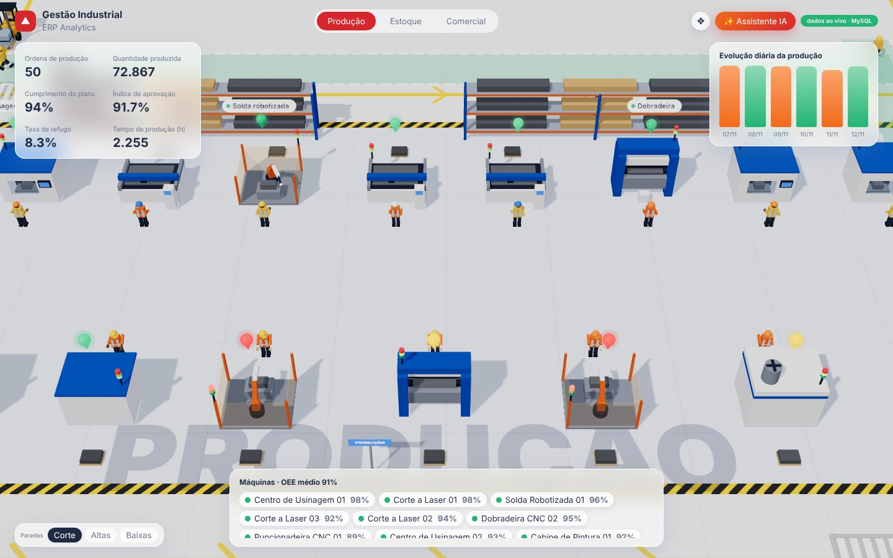
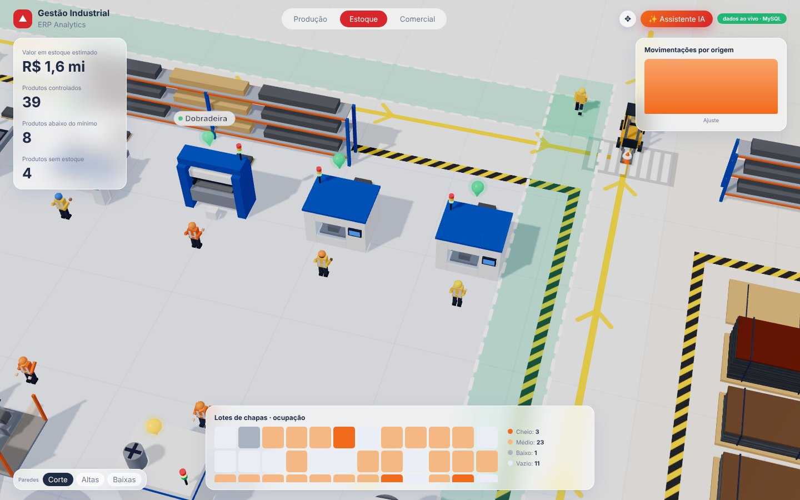
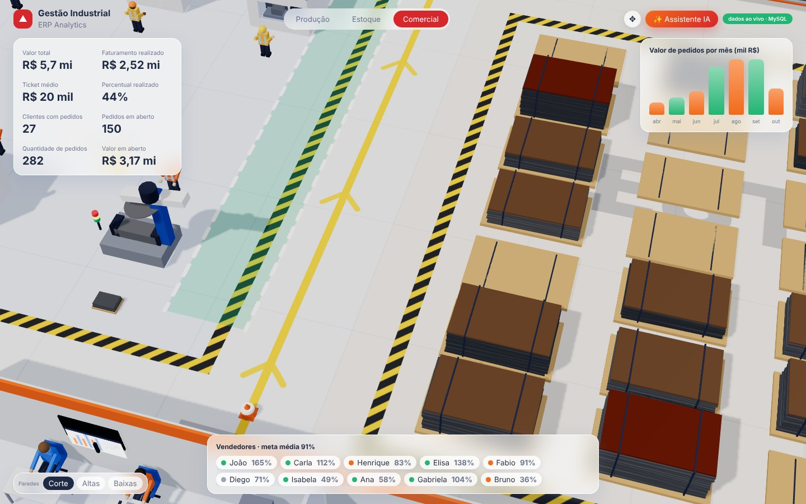
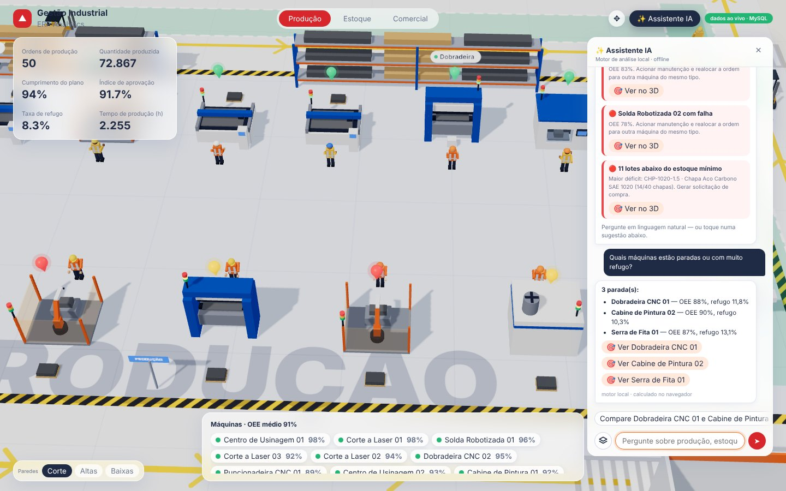
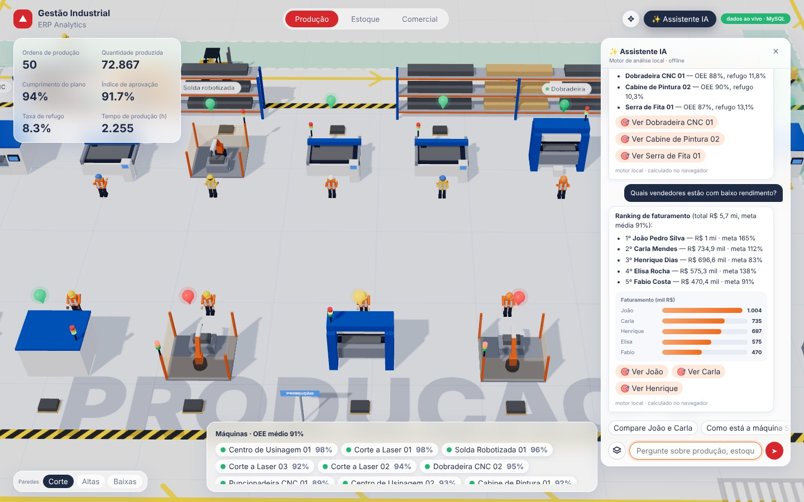
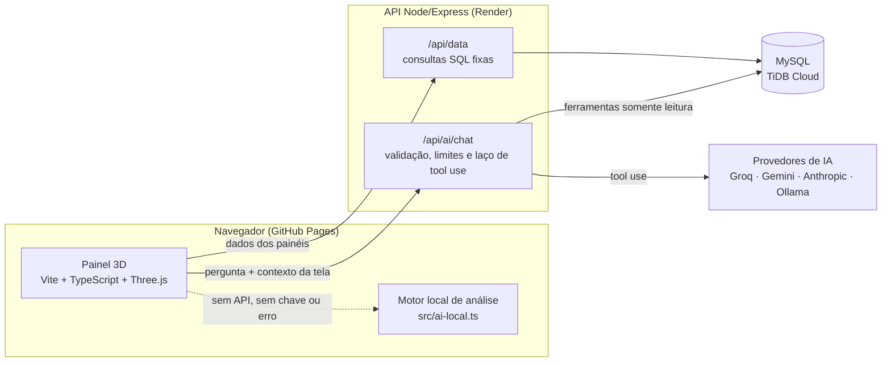

<div align="center">

# ERP Industrial Analytics 3D

**Painel industrial em 3D com assistente de IA: o gestor conversa com os dados da fábrica e a câmera voa até a máquina, o lote ou o vendedor citado.**


[**Ver demonstração ao vivo**](https://1959414-5.github.io/erp-industrial-3d/) ·
[Estudo de caso completo](https://1959414-5.github.io/meu-portfolio/projeto-erp-industrial-3d.html) ·
[Guia do assistente de IA](docs/ASSISTENTE_IA.md) ·
[Guia de deploy](docs/DEPLOY_NUVEM.md)

<br>



</div>

> **Aviso.** Projeto independente de portfólio. Todos os dados (clientes, pedidos, máquinas, vendedores, estoque) são
> **fictícios**, gerados por scripts SQL deste repositório. Não há dados, marcas ou documentos de nenhuma empresa real.

---

## Sumário

1. [Visão geral](#visão-geral)
2. [Funcionalidades](#funcionalidades)
3. [Demonstração](#demonstração)
4. [Arquitetura](#arquitetura)
5. [Stack](#stack)
6. [Assistente de IA](#assistente-de-ia)
7. [Banco de dados e dados de demonstração](#banco-de-dados-e-dados-de-demonstração)
8. [Como o status e o OEE das máquinas são calculados](#como-o-status-e-o-oee-das-máquinas-são-calculados)
9. [API](#api)
10. [Executando localmente](#executando-localmente)
11. [Deploy gratuito](#deploy-gratuito)
12. [Configuração](#configuração)
13. [Segurança](#segurança)
14. [Estrutura do repositório](#estrutura-do-repositório)
15. [Decisões de projeto](#decisões-de-projeto)
16. [Limitações conhecidas](#limitações-conhecidas)
17. [Roadmap](#roadmap)
18. [Autora](#autora)

---

## Visão geral

Painéis de BI tradicionais mostram números, mas não dizem **onde** está o problema nem **o que fazer** a respeito.
Este projeto combina três ideias:

- **Contexto espacial.** A fábrica é uma cena 3D navegável (máquinas, lotes de chapas, escritório comercial). O gestor vê
  onde está a máquina parada ou o lote crítico.
- **Dados reais de um banco relacional.** A cena é alimentada por uma API Node/Express que lê um banco MySQL modelado
  como um ERP industrial (vendas, estoque e produção).
- **Conversa em linguagem natural.** Um assistente de IA responde perguntas em português ("quais máquinas estão paradas?",
  "quem está abaixo da meta?") usando *function calling* sobre consultas fixas e somente leitura, e leva a câmera até o item citado.

O resultado é uma aplicação *full stack* de ponta a ponta: modelagem de dados, API, front-end 3D, integração com LLMs, segurança
e deploy em nuvem sem custo.

## Funcionalidades

| Área | O que faz |
| --- | --- |
| **Cena 3D** | Planta de uma metalúrgica de médio porte com 15 máquinas, lotes de chapas, escritório comercial, colaboradores e empilhadeiras animados. Câmera livre, modo de paredes (cortadas, altas ou baixas). |
| **Produção** | Ordens, quantidade produzida, cumprimento do plano, índice de aprovação, refugo, evolução diária, status e OEE estimado por máquina. Cada máquina tem sinalização luminosa e um cartão de detalhes. |
| **Estoque** | Lotes de chapas com ocupação, saldo, mínimo e déficit. Na planta 3D, cada lote é um palete com chapas empilhadas e a altura da pilha acompanha a ocupação. |
| **Comercial** | Faturamento, ticket médio, pedidos em aberto, ranking de vendedores com percentual da meta. |
| **Assistente de IA** | Chat com resumo automático, análise por item, ranking, comparação, projeção, sugestão de reposição e ação no 3D ("Ver no 3D"). |
| **Seletor de modelos** | Lista provedores e modelos, mostra status e cota e permite fixar um modelo ou deixar no modo automático. |
| **Sugestões** | Perguntas seguintes geradas pela própria IA a partir da resposta, da aba e do item selecionado. |
| **Painéis arrastáveis** | Modo mover (botão ✥): o usuário reposiciona KPIs, gráficos e chat. A posição fica salva no navegador. |
| **Funciona sem backend** | Sem API, o painel usa um *snapshot* estático e, em último caso, dados de exemplo embutidos. O chat cai para o motor local. |

## Demonstração

<table>
  <tr>
    <td width="50%"><br><sub><b>Estoque.</b> Lotes por ocupação, saldo e mínimo.</sub></td>
    <td width="50%"><br><sub><b>Comercial.</b> Faturamento e vendedores por percentual da meta.</sub></td>
  </tr>
  <tr>
    <td width="50%"><br><sub><b>Assistente.</b> Máquinas paradas ou com refugo alto, com botão "Ver no 3D".</sub></td>
    <td width="50%"><br><sub><b>Assistente.</b> Ranking de faturamento com gráfico e atalhos.</sub></td>
  </tr>
</table>

<sub>As capturas de tela do assistente acima mostram o <b>motor local</b> (modo offline). Com um provedor configurado, o selo do chat
mostra o modelo ativo e cada resposta lista as ferramentas consultadas e os tokens usados.</sub>

**Roteiro sugerido (3 minutos):** abrir o assistente e ver o briefing automático → perguntar "quais máquinas estão paradas ou
com muito refugo?" e clicar em *Ver no 3D* → "quais vendedores estão com baixo rendimento?" → aba Estoque: "sugira uma reposição"
→ aba Comercial: "projeção de pedidos".

## Arquitetura



**Fluxo de uma pergunta ao assistente**

1. O navegador envia a pergunta, o histórico curto e o contexto da tela (aba ativa e item selecionado).
2. A API valida o corpo, aplica o limite por IP e o teto diário e chama o provedor de IA com a lista de ferramentas.
3. O modelo escolhe uma ferramenta; a API executa uma **consulta SQL fixa e parametrizada** e devolve o resultado ao modelo
   (laço de até 6 voltas).
4. A resposta volta com texto, ações (focar no 3D, abrir aba), sugestões e as ferramentas consultadas.
5. Se algo falhar (sem chave, limite, timeout), o front responde com o **motor local** sobre os mesmos dados.

## Stack

| Camada | Tecnologias |
| --- | --- |
| Front-end | Vite, TypeScript, Three.js (cena, modelos procedurais, iluminação e animação), HTML e CSS |
| API | Node.js 18+, Express, `mysql2`, `cors` |
| Banco | MySQL 8 (local) e TiDB Cloud Starter, compatível com MySQL (nuvem) |
| IA | LLMs com *function calling* via adaptadores para Groq (gpt-oss), Gemini, Anthropic (Claude) e Ollama |
| Deploy | GitHub Pages + GitHub Actions (front), Render (API) e TiDB Cloud (banco), todos em plano gratuito |

## Assistente de IA

O assistente **não escreve SQL**. O modelo recebe um conjunto fechado de ferramentas e escolhe qual chamar e com quais parâmetros.
Cada ferramenta executa uma consulta fixa, parametrizada e somente leitura.

| Ferramenta | Para que serve |
| --- | --- |
| `visao_geral` | KPIs das três abas e contagens gerais |
| `listar_maquinas` | Máquinas com status, OEE, refugo, produção e ordem atual |
| `listar_vendedores` | Faturamento, percentual da meta, pedidos, ticket médio e principal cliente |
| `listar_lotes` | Saldo, mínimo, déficit, valor, ocupação e localização dos lotes |
| `serie_temporal` | Série diária ou mensal com tendência e projeção linear (já calculadas em código, com R²) |
| `top_clientes` | Clientes com maior valor em pedidos |
| `pedidos_por_status` | Quantidade e valor por status do pedido |
| `historico_maquina` | Produção e refugo diários de uma máquina |
| `focar_no_3d` | Move a câmera e seleciona o item (ferramenta de interface) |
| `abrir_aba` | Troca a aba do painel (ferramenta de interface) |

**Provedores.** A camada é agnóstica de provedor e todos usam as mesmas ferramentas:

| Provedor | Custo | Observação |
| --- | --- | --- |
| Groq (`gpt-oss-120b`) | gratuito, com limites | padrão da demonstração publicada |
| Gemini (2.5 Flash) | gratuito, com limites | pode usar os prompts para melhorar produtos do Google; não envie dados sensíveis |
| Anthropic (Claude) | pago | requer crédito na conta |
| Ollama | gratuito, roda no seu PC | defina `OLLAMA_MODEL` |

**Resiliência.** Sem chave, com cota esgotada ou com erro do provedor, o chat avisa e responde com o motor local (estatística e
regras: z-score, médias, regressão linear). Se um modelo for aposentado pelo provedor, a API descobre outro disponível na mesma chave.
Ao fixar um modelo no seletor, **não há troca silenciosa**: se falhar, o painel mostra o erro real.

**Qualidade das respostas.** O prompt de sistema proíbe inventar números e exige o uso das ferramentas. Cálculos (projeção, médias)
são feitos em código, não pelo modelo. Nomes parciais ("Diego") são resolvidos pelas ferramentas de listagem antes de concluir
que um item não existe. A tela mostra as ferramentas consultadas em cada resposta.

Detalhes, decisões e roteiro de demonstração: [`docs/ASSISTENTE_IA.md`](docs/ASSISTENTE_IA.md).

## Banco de dados e dados de demonstração

O banco `erp_industrial_analytics` modela um ERP industrial: cadastros (clientes, fornecedores, produtos), vendas, estoque e produção, com as
views `vw_faturamento_pedidos` e `vw_saldo_estoque`. Este projeto acrescenta a tabela `vendedores` (com FK em `pedidos_venda`) e a tabela de controle `seed_log`.

Os scripts em [`db/`](db) são **idempotentes** (podem ser reexecutados sem duplicar dados) e devem rodar nesta ordem:

| Script | O que faz |
| --- | --- |
| `00_inspecionar_schema.sql` | Consultas para inspecionar o schema existente |
| `01_seed_portfolio.sql` | Cria `vendedores`, liga aos pedidos, cadastra chapas e gera saldo de estoque |
| `02_seed_fix.sql` | Corrige o que as restrições `CHECK` do banco barraram na carga inicial (origem da movimentação de estoque e status dos pedidos) |
| `03_seed_empresa_media.sql` | Expande para uma empresa de médio porte: 10 vendedores, 38 chapas, 15 máquinas e volume de pedidos |
| `04_dados_variados.sql` | Cria cenários variados para a demonstração (veja abaixo) |

**Cenários do script 04**, para o painel não mostrar "tudo verde":

- **Máquinas:** 10 operando (com OEE diferentes), 2 com falha (refugo alto) e 3 paradas.
- **Vendedores:** de 36% a 165% da meta, do desempenho excelente ao bem abaixo do esperado.
- **Estoque:** lotes cheios, equilibrados, abaixo do mínimo, críticos e sem estoque.
- **Volume:** mais ordens de produção, cerca de 60 dias de apontamentos e mais pedidos.
- **Plano:** metas das ordens ajustadas para um cumprimento do plano realista (cerca de 94%).

## Como o status e o OEE das máquinas são calculados

O banco **não tem sensores** de chão de fábrica. Por isso, status e OEE são **estimativas** feitas a partir de `apontamentos_producao`
(em `api/queries.js`):

| Indicador | Regra |
| --- | --- |
| **Operando** | a máquina apontou produção dentro da janela de `MACHINE_ACTIVE_HOURS` (padrão 24 h), contada a partir do **apontamento mais recente da base** |
| **Com falha** | refugo acima de 15% da produção |
| **Parada** | demais casos (sem apontamento na janela) |
| **OEE** | quantidade aprovada ÷ quantidade produzida (aproximação, sem disponibilidade nem desempenho de ciclo) |

A janela é medida em relação ao último apontamento da base, e não à data de hoje, para a demonstração continuar coerente
mesmo com dados que envelhecem.

## API

| Método e rota | Descrição |
| --- | --- |
| `GET /` e `GET /api/ping` | Verificação simples de que o serviço está no ar (útil para monitor de disponibilidade) |
| `GET /api/health` | Testa a conexão com o banco |
| `GET /api/data` | Dados das três abas, máquinas, lotes e vendedores, consumidos pelo painel |
| `GET /api/ai/status` | Provedor e modelo ativos |
| `GET /api/ai/models` | Provedores e modelos disponíveis, status e cota |
| `POST /api/ai/chat` | Pergunta ao assistente (laço de *tool use*) |
| `GET /api/ai/selftest` | Diagnóstico: testa cada provedor configurado e lista os modelos |

## Executando localmente

**Pré-requisitos:** Node.js 18+ e MySQL 8 com o banco `erp_industrial_analytics` (schema do ERP).

**1. Popular o banco** (uma vez): no MySQL Workbench, execute os scripts de [`db/`](db) em ordem (`01` a `04`).

**2. Subir a API**

```powershell
cd api
npm install
Copy-Item .env.example .env      # edite a senha do MySQL no .env
npm start
```

Teste: <http://localhost:3001/api/health> deve responder `"ok": true`.

**3. Subir o painel** (em outro terminal)

```powershell
# na raiz do projeto
npm install
Copy-Item .env.example .env      # já aponta para http://localhost:3001
npm run dev
```

Abra <http://localhost:5173>. O painel busca os dados da API automaticamente.

**Ordem de busca dos dados no front:** 1) API (`VITE_API_URL`); 2) `public/data.json` (snapshot estático); 3) dados de exemplo embutidos.
Assim o painel abre mesmo sem banco.

**Versão estática sem API:** `cd api && npm run snapshot` grava `public/data.json` a partir do MySQL; comente `VITE_API_URL` no `.env` e rode `npm run build`.

## Deploy gratuito

| Peça | Onde | Custo |
| --- | --- | --- |
| Painel 3D (estático) | GitHub Pages, publicado por GitHub Actions | gratuito |
| API Node/Express e IA | Render (Web Service, plano Free) | gratuito; dorme após 15 min sem acesso e acorda em cerca de 1 minuto |
| Banco MySQL | TiDB Cloud Starter (compatível com MySQL, conexão com TLS) | gratuito dentro da cota mensal |

Passo a passo completo (exportar e importar o banco, configurar o Render, variável `API_URL` do GitHub e monitor de disponibilidade):
[`docs/DEPLOY_NUVEM.md`](docs/DEPLOY_NUVEM.md).

> **Nota sobre a hospedagem gratuita:** a primeira requisição após um período ocioso pode levar cerca de 1 minuto, pois a API precisa
> acordar. Um monitor gratuito apontando para `/api/ping` a cada 5 minutos mantém a API acordada.

## Configuração

**API** (`api/.env`, copiado de `api/.env.example`; **nunca** versionar o `.env`):

| Variável | Descrição | Padrão |
| --- | --- | --- |
| `DB_HOST`, `DB_PORT`, `DB_USER`, `DB_PASSWORD`, `DB_NAME` | Conexão com o MySQL | `127.0.0.1`, `3306`, `root`, vazio, `erp_industrial_analytics` |
| `DB_SSL` | `true` para bancos em nuvem (TiDB Cloud exige TLS) | vazio |
| `PORT` | Porta da API | `3001` |
| `AI_PROVIDER` | `groq`, `gemini`, `anthropic` ou `ollama` (os demais configurados viram reserva) | `groq` |
| `GROQ_API_KEY`, `GEMINI_API_KEY`, `ANTHROPIC_API_KEY`, `OLLAMA_MODEL` | Credenciais e modelos dos provedores | vazio |
| `GROQ_MODEL`, `GEMINI_MODEL`, `ANTHROPIC_MODEL` | Modelo de cada provedor | veja `.env.example` |
| `AI_RATE_LIMIT` | Perguntas por minuto por IP | `20` |
| `AI_DAILY_LIMIT` | Teto diário de perguntas (`0` desliga) | `300` |
| `CORS_ORIGIN` | Origens permitidas, separadas por vírgula | qualquer origem |
| `MACHINE_ACTIVE_HOURS` | Janela para considerar uma máquina operando | `24` |

**Front** (`.env` na raiz): `VITE_API_URL` aponta para a API. No deploy, o valor vem da variável `API_URL` do repositório.

## Segurança

- **Chaves apenas no servidor.** Chaves de IA e senha do banco ficam em variáveis de ambiente (Render) ou em `.env` ignorado pelo Git; o front nunca as vê.
- **Sem SQL gerado por modelo.** Ferramentas fixas, parametrizadas e somente leitura.
- **Defesa contra *prompt injection*.** Dados vindos do banco são tratados como dados; o prompt manda ignorar ordens que apareçam dentro deles.
- **Limites.** Tamanho de mensagem, histórico (10 mensagens), voltas do laço (6), requisições por minuto por IP e teto diário.
- **CORS restringível** com `CORS_ORIGIN` em produção.
- **Saída segura.** O front escapa o HTML antes de renderizar a resposta da IA.
- **Banco em nuvem com TLS** (`DB_SSL=true`, versão mínima TLS 1.2 e validação do certificado).

## Estrutura do repositório

```
erp-industrial-3d/
├── src/                    painel 3D (Vite + TypeScript + Three.js)
│   ├── scene.ts            cena, câmera, iluminação, interação
│   ├── machines.ts         modelos 3D das máquinas
│   ├── props.ts            props, colaboradores e veículos
│   ├── office.ts, floor.ts escritório comercial e piso da fábrica
│   ├── stock.ts            lotes de chapas
│   ├── data.ts             carga dos dados (API, snapshot ou exemplo)
│   ├── ui.ts, style.css    painéis, KPIs, gráficos e estilos
│   ├── ai.ts               chat, seletor de modelos e sugestões
│   └── ai-local.ts         motor de análise local (offline)
├── api/                    API Node/Express
│   ├── server.js           rotas, CORS e conexão com o banco
│   ├── queries.js          consultas SQL e regras de status/OEE
│   ├── ai.js               ferramentas, laço de tool use, provedores, limites
│   └── snapshot.js         gera public/data.json
├── db/                     scripts SQL de carga (idempotentes)
├── docs/                   guias de IA e de deploy, imagens
├── public/                 data.json (snapshot opcional)
└── .github/workflows/      deploy no GitHub Pages
```

## Decisões de projeto

**Por que *tool use* e não text-to-SQL?** SQL escrito por modelo pode ser errado, pesado ou destrutivo, e é difícil de auditar.
Com ferramentas fixas, o conjunto de operações é fechado e testável.

**Por que um motor local se há LLM?** Disponibilidade e custo. O site publicado no GitHub Pages não tem backend próprio, e a
demonstração não deve depender de internet, chave ou cota. É um padrão de degradação graciosa. O motor local é estatística e regras,
**não** IA generativa; a parte generativa é o modo com provedor.

**Por que vários provedores?** Planos gratuitos mudam e aposentam modelos. Uma camada agnóstica evita o acoplamento e permite trocar
de provedor sem alterar as ferramentas.

**Por que mostrar a cota de forma "honesta"?** Nenhum provedor expõe o saldo em dinheiro pela API. O painel combina os cabeçalhos
de limite devolvidos pelo provedor com a contagem de uso medida pelo próprio servidor, e diz isso na interface.

**Por que o TiDB Cloud?** É compatível com MySQL e tem plano gratuito. Foram necessários dois ajustes de compatibilidade nos scripts:
`INTERVAL ROUND(expr) DAY` em vez de `INTERVAL (expr) DAY`, e `CAST(... AS SIGNED)` em subtrações com chaves `BIGINT UNSIGNED`.

## Limitações conhecidas

- **Status e OEE são estimativas** feitas a partir dos apontamentos de produção, sem sensores. O OEE aqui é aprovado ÷ produzido.
- **"Produzido hoje" é acumulado** no período dos apontamentos, não o total do dia.
- **A projeção é uma regressão linear simples**, sem sazonalidade; o chat mostra o R² para indicar a confiança.
- **A IA pode errar.** O uso de ferramentas fixas reduz o risco, mas não o elimina.
- **Somente leitura e sem autenticação.** A demonstração pública não altera dados e não tem login, de propósito.
- **Partida a frio no plano gratuito** do Render (cerca de 1 minuto na primeira requisição após inatividade).
- **Memória de conversa curta** (últimas 10 mensagens).

## Roadmap

- [ ] Autenticação com perfis (gestor e vendedor), cada um vendo apenas o que lhe cabe
- [ ] Dados em tempo real, a partir de sensores ou eventos das máquinas, no lugar da estimativa por apontamentos
- [ ] Testes automatizados das ferramentas da IA, com perguntas-gabarito avaliadas a cada mudança de prompt
- [ ] Respostas em *streaming*
- [ ] Alertas proativos (e-mail ou mensagem) quando um indicador cruzar um limite
- [ ] Cache e índices no banco; API sem partida a frio
- [ ] Previsão com sazonalidade

## Autora

**Bárbara Cabral Paschoalin**: analista de dados e desenvolvedora, Maringá/PR.
[Portfólio](https://1959414-5.github.io/meu-portfolio/) ·
[LinkedIn](https://www.linkedin.com/in/bárbara-paschoalin-980b52185) ·
[GitHub](https://github.com/1959414-5)
